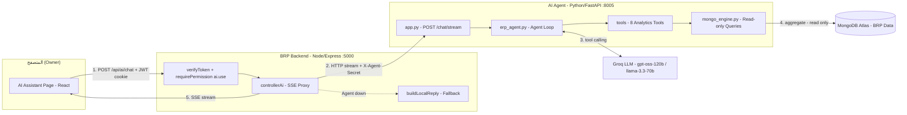
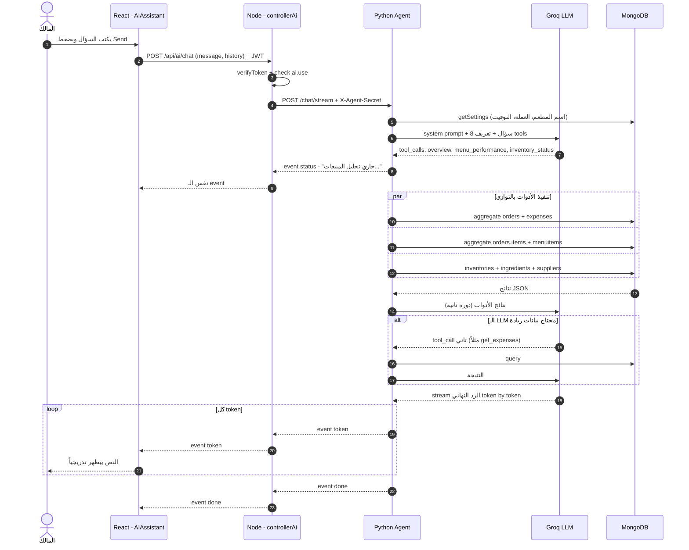
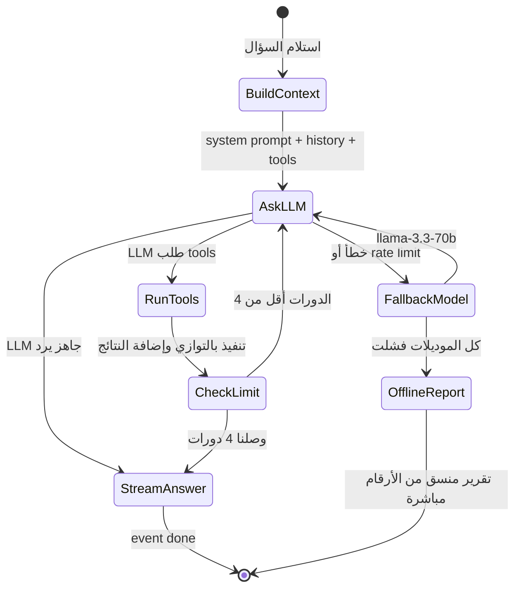
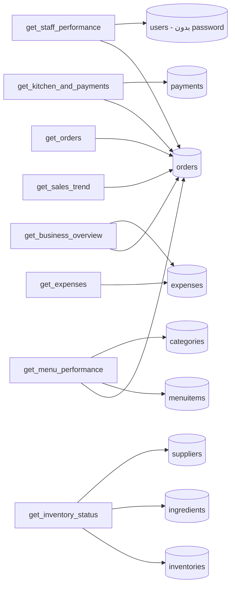
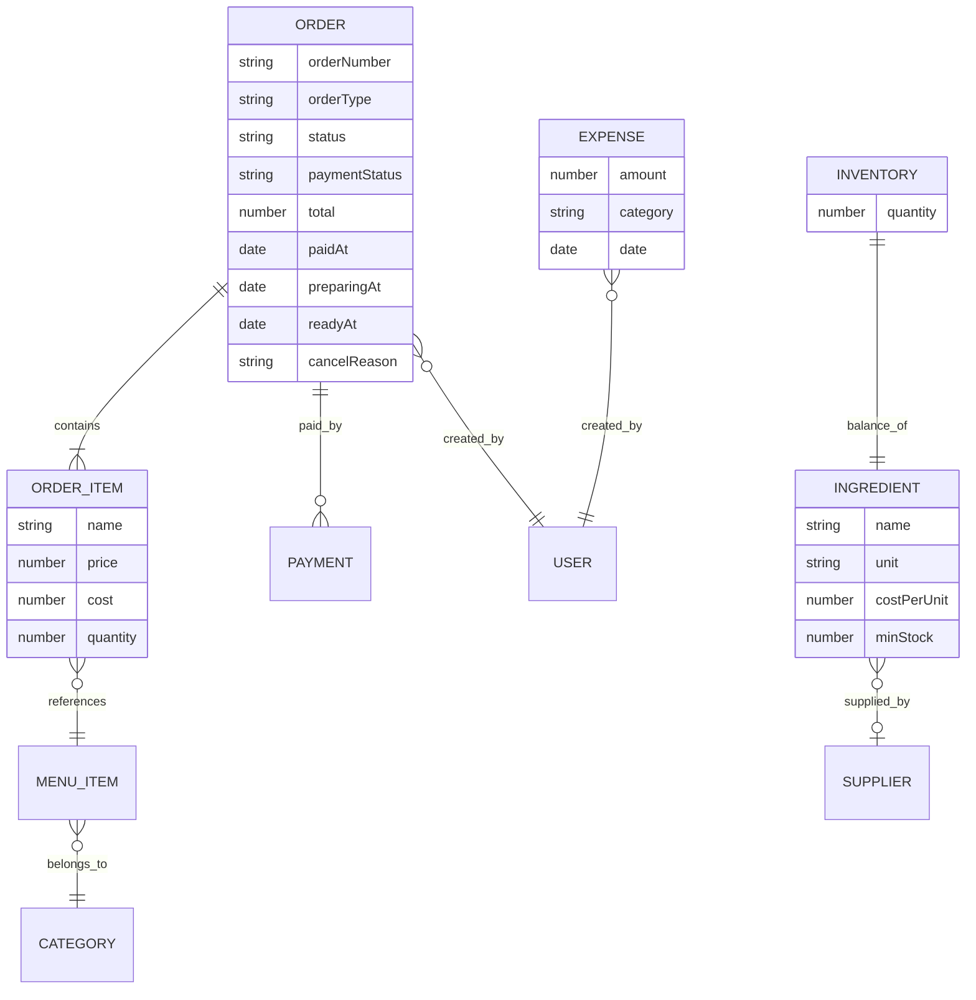
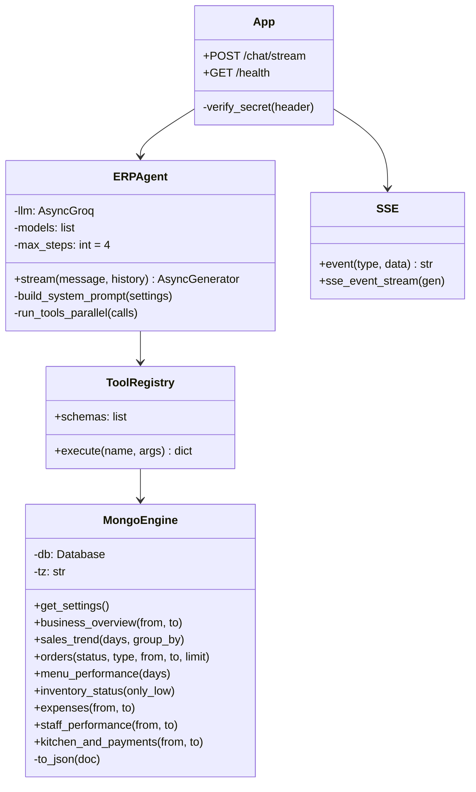
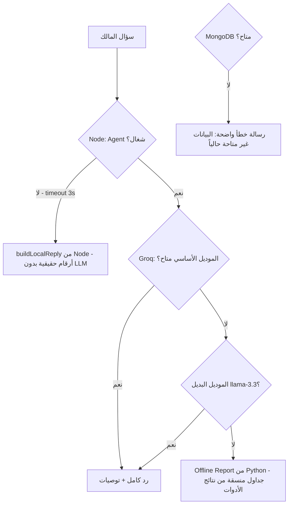
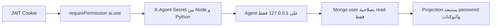
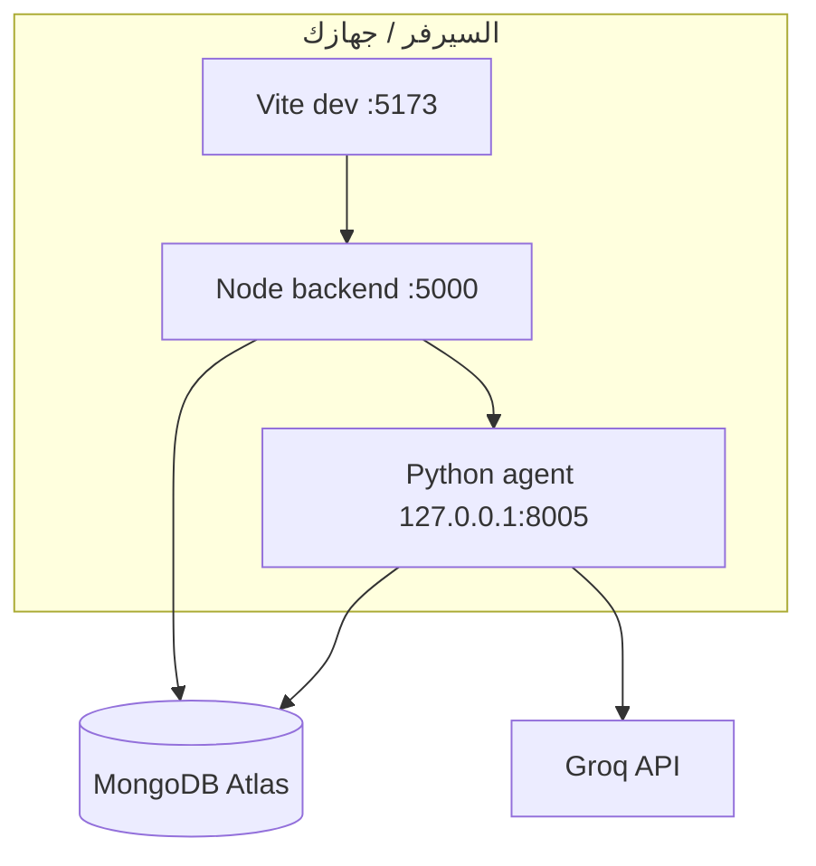

# System Design: Restaurant Owner AI Agent

## 1. الصورة الكبيرة (High-Level Architecture)



| الطبقة | المسؤولية | **لا** تعمل |
|---|---|---|
| **React (AIAssistant.jsx)** | عرض الشات، قراءة الـ stream، عرض Markdown والـ status | مفيهاش أي منطق بيانات |
| **Node (controllerAi.js)** | التحقق من الهوية والصلاحية، تمرير الـ stream، الـ fallback | مابيكلمش الـ LLM |
| **Python Agent** | التفكير، اختيار الأدوات، صياغة الرد والتوصيات | مابيعملش auth للمستخدم ومابيكتبش في الداتابيز |
| **MongoDB** | مصدر الحقيقة الوحيد | — |

---

## 2. رحلة سؤال واحد (Sequence Diagram)

مثال: المالك بيسأل **"إيه أخبار المطعم النهاردة؟"**



---

## 3. منطق الـ Agent من جوه (Agent Loop)



**قواعد الـ System Prompt:**
1. أي رقم لازم يكون جاي من tool، ممنوع التأليف.
2. يرد بلغة السؤال (عربي مصري / English).
3. Markdown: جداول + نقاط + أرقام بالعملة.
4. يختم بـ **💡 توصيات للمالك** (2–4 نقاط عملية).
5. التاريخ والوقت الحالي بتوقيت `Africa/Cairo` جوه الـ prompt عشان يفهم "النهاردة" و"الأسبوع اللي فات".

---

## 4. الأدوات ومصادر البيانات (Data Map)



### العلاقات بين الـ Collections اللي الـ Agent بيقراها



### معادلات الحساب (نفس منطق Dashboard عشان الأرقام تطابق)

| المؤشر | المعادلة |
|---|---|
| Revenue | مجموع `total` للأوردرات `paymentStatus = paid` و `paidAt` جوه الفترة |
| COGS (تكلفة الطعام) | مجموع `items.cost × items.quantity` لنفس الأوردرات |
| Gross Profit | Revenue − COGS |
| Net Profit | Gross Profit − Expenses |
| هامش الصنف | `(price − cost) / price` |
| تكلفة إعادة الشراء | `(minStock − quantity) × costPerUnit` لكل خامة ناقصة |
| وقت التحضير | متوسط `readyAt − preparingAt` |
| مقارنة الفترة | نفس الطول قبل الفترة الحالية مباشرة: `% change` |

---

## 5. تصميم الكود (Python Modules)



---

## 6. شكل الـ Stream بين الطبقات (SSE Contract)

| Event | Data | الواجهة بتعمل إيه |
|---|---|---|
| `status` | `{"text": "جاري فحص المخزون..."}` | تعرض pill صغير متحرك فوق الرد |
| `token` | `{"text": "..."}` | تضيف النص للرسالة الحالية |
| `done` | `{"provider": "groq", "tools": [...]}` | تخفي المؤشر وتفعّل زر Send |
| `error` | `{"message": "..."}` | toast + الرد الاحتياطي |

**مثال على السلك:**
```text
event: status
data: {"text":"جاري تحليل المبيعات والأرباح..."}

event: token
data: {"text":"**ملخص اليوم:** الإيرادات "}

event: done
data: {"provider":"groq","tools":["get_business_overview"]}
```

---

## 7. لو حاجة وقعت (Failure Handling)



> [!NOTE]
> في كل الحالات المالك **دايماً** بياخد رد. أسوأ حالة: أرقام حقيقية من غير صياغة ذكية.

---

## 8. الأمان (Security Layers)



| الخطر | الحماية |
|---|---|
| موظف عادي يسأل عن المرتبات والأرباح | `ai.use` للـ Owner/Manager فقط |
| حد يكلم الـ Agent مباشرة | بيسمع على `127.0.0.1` + shared secret |
| Prompt injection يطلب حذف بيانات | مفيش أي tool بتكتب + Mongo user read-only |
| تسريب بيانات حساسة | استبعاد `password`, `passwordChangedAt`, blacklist tokens |
| استهلاك زيادة للـ API | حد 4 دورات للـ tools + `history` آخر 8 رسائل + rate limit على `/api/ai/chat` |

---

## 9. التشغيل (Deployment)



**متغيرات البيئة:**

| الملف | المتغير | الوظيفة |
|---|---|---|
| `Backend/.env` | `AGENT_URL=http://127.0.0.1:8005` | عنوان الـ Agent |
| `Backend/.env` | `AGENT_SECRET=...` | السر المشترك |
| `Agent/backend/.env` | `MONGO_URL` (يُفضّل user read-only) | الداتابيز |
| `Agent/backend/.env` | `AGENT_SECRET` | نفس السر |
| `Agent/backend/.env` | `GROQ_API_KEY` | موجود بالفعل |

---

## 10. هيكل الملفات النهائي

```text
Agent/
├── requirements.txt          (+ pymongo[srv], dnspython)
└── backend/
    ├── .env
    ├── app.py                FastAPI: /chat/stream, /health
    ├── erp_agent.py          Agent loop + system prompt
    ├── tools.py              [NEW] 8 tool schemas + registry
    ├── mongo_engine.py       [NEW] read-only aggregations
    └── stream_utils.py       SSE helpers
    (حذف: erp_engine.py, restaurant_erp.db, frontend/)

BRP-System/
├── Backend/src/controllers/controllerAi.js   SSE proxy + fallback
└── frontend/src/Pages/AIAssistant.jsx        streaming + markdown + status
```
